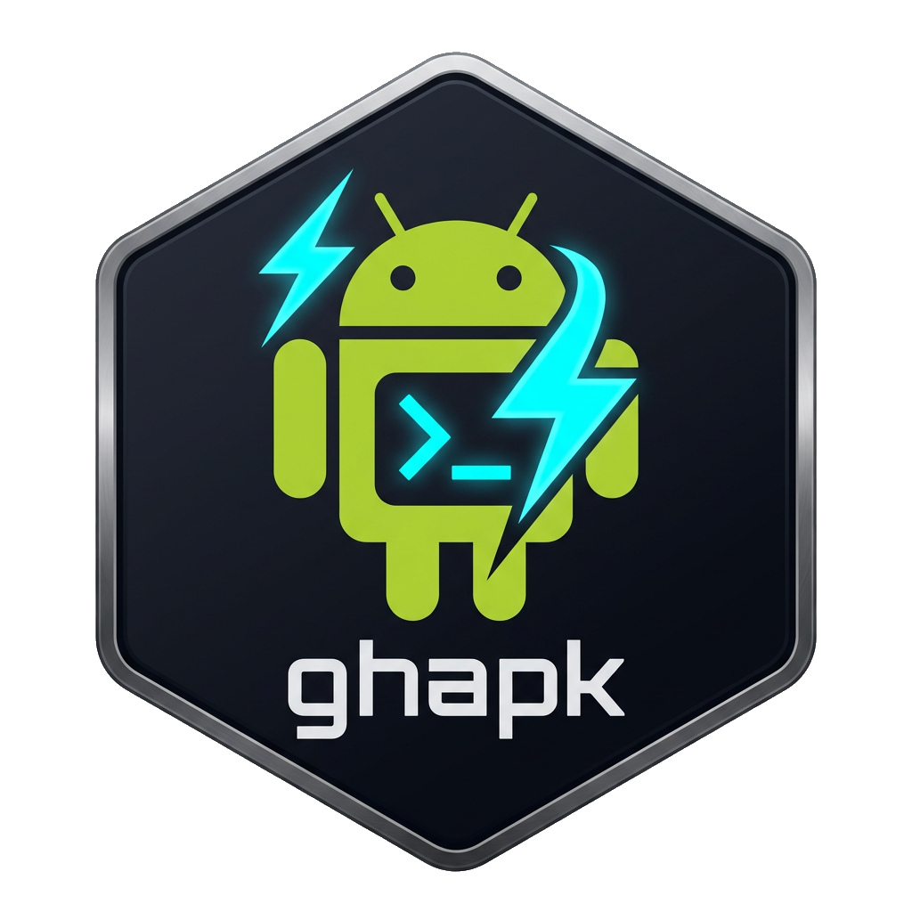

<p align="center">
  
</p>

<h1 align="center">ghapk</h1>

<p align="center">
  <strong>GitHub Actions &rarr; APK installer, built for developers on Android (Termux), Linux & macOS.</strong>
</p>

<p align="center">
  <a href="https://github.com/ThatOn3Gu7/ghapk/releases"></a>
  <a href="https://go.dev/"></a>
  <a href="https://github.com/ThatOn3Gu7/ghapk/blob/master/LICENSE"></a>
  <a href="https://termux.dev/"></a>
</p>

---

## ⚡ What is ghapk?

Testing Android apps built with **GitHub Actions** usually means endless friction: opening your phone's browser, authenticating to GitHub, finding the workflow run, downloading a multi-hundred megabyte zip file, extracting the `.apk`, finding it in your file manager, and manually installing it.

**`ghapk` eliminates all of that.**

With a single keyboard shortcut or touch tap from your terminal, `ghapk`:
1. Discovers the latest successful GitHub Actions workflow runs for your repository.
2. Inspects your actual physical device hardware (CPU architecture / ABI, Android SDK level, debug/release preference).
3. Evaluates and scores every available artifact to automatically pick the optimal build for your device.
4. Streams and extracts the APK directly.
5. Hands the APK off to Android's native package installer (or `xdg-open` on desktop).

All through a sleek, reactive, **LazyGit-style Terminal User Interface (TUI)** that cleans up after itself and leaves your terminal scrollback untouched.

```text
  ██████╗ ██╗  ██╗   █████╗ ██████╗ ██╗  ██╗
 ██╔════╝ ██║  ██║  ██╔══██╗██╔══██╗██║ ██╔╝
 ██║  ███╗███████║  ███████║██████╔╝█████╔╝ 
 ██║   ██║██╔══██║  ██╔══██║██╔═══╝ ██╔═██╗ 
 ╚██████╔╝██║  ██║  ██║  ██║██║     ██║  ██╗
  ╚═════╝ ╚═╝  ╚═╝  ╚═╝  ╚═╝╚═╝     ╚═╝  ╚═╝
             GitHub Actions APK Manager
```

---

## 🚀 Quick Install

### One-line curl (Recommended)

Run this in **Termux**, **Linux**, or **macOS**. It automatically detects your operating system and CPU architecture, downloads the right binary, and puts it in your path:

```bash
curl -fsSL https://raw.githubusercontent.com/ThatOn3Gu7/ghapk/master/install.sh | bash
```

*(Or with `wget`: `wget -qO- https://raw.githubusercontent.com/ThatOn3Gu7/ghapk/master/install.sh | bash`)*

---

### Prerequisites

`ghapk` uses GitHub's official command line interface (`gh`) to communicate with the GitHub Actions API securely:

```bash
# On Android (Termux)
pkg install gh
gh auth login

# On macOS (Homebrew)
brew install gh
gh auth login

# On Ubuntu / Debian
sudo apt install gh
gh auth login
```

Once logged in, simply launch:

```bash
ghapk
```

---

## 📦 Pre-Built Binaries

Pre-compiled standalone binaries with zero external runtime dependencies are available on the **[Releases](https://github.com/ThatOn3Gu7/ghapk/releases)** page:

| Platform | Architecture | Target File |
| :--- | :--- | :--- |
| **Android (Termux)** | `arm64` (aarch64) | [`ghapk-android-arm64`](https://github.com/ThatOn3Gu7/ghapk/releases/latest) |
| **Linux** | `amd64` (x86_64) | [`ghapk-linux-amd64`](https://github.com/ThatOn3Gu7/ghapk/releases/latest) |
| **Linux** | `arm64` (aarch64) | [`ghapk-linux-arm64`](https://github.com/ThatOn3Gu7/ghapk/releases/latest) |
| **macOS** | `arm64` (Apple Silicon) | [`ghapk-darwin-arm64`](https://github.com/ThatOn3Gu7/ghapk/releases/latest) |
| **macOS** | `amd64` (Intel) | [`ghapk-darwin-amd64`](https://github.com/ThatOn3Gu7/ghapk/releases/latest) |
| **Windows** | `amd64` (x86_64) | [`ghapk-windows-amd64.exe`](https://github.com/ThatOn3Gu7/ghapk/releases/latest) |

### Install via Go

If you have Go installed:

```bash
go install github.com/ThatOn3Gu7/ghapk@latest
```

---

## 🎮 Navigation & Keybindings

`ghapk` is built with [Bubble Tea](https://github.com/charmbracelet/bubbletea) and supports both **keyboard navigation** and **mouse / touch gestures**:

```
 1 Repos   2 Flows   3 Builds   4 Device
╭─ Builds ────────────────────╮╭─ Artifacts ────────────────────────────╮
│ ✓ #42 feat: block+pipe logo ││ ✓ app-arm64-v8a-debug       14.2 MB  │
│ ✓ #41 fix: centering        ││ · app-universal-debug       20.1 MB  │
│ ✗ #40 refactor: split       │╰───────────────────────────────────────╯
│                             │╭─ Details ──────────────────────────────╮
│                             ││ feat: block+pipe logo                 │
│                             ││ Result    ✓ success                   │
│                             ││ Build     #42                         │
│                             ││ Branch    main                        │
│                             ││ Workflow  Build APK                   │
│                             ││                                       │
│                             ││ Install Download Open                 │
╰─────────────────────────────╯╰───────────────────────────────────────╯
```

| Key | Action |
| :--- | :--- |
| `Tab` / `Shift+Tab` | Cycle through screens |
| `1` – `4` | Jump to Repos, Flows, Builds, or Device |
| `Enter` | Select a repo, branch, or workflow; press again to move on |
| `↑` `↓` / `j` `k` | Move cursor in the current list |
| `g` / `G` | Jump to top / bottom |
| `Ctrl+D` / `Ctrl+U` | Half-page down / up |
| `Enter` / `→` | Open a build’s artifacts; Enter on an artifact downloads and installs it |
| **Mouse / Touch** | Tap to select; tap the repo name for the picker or a bottom hint to run it; swipe or drag the scroll bar in Help |
| `d` | Download selected artifact to local cache |
| `i` | Download and immediately launch installer on device |
| `R` | Repository picker (accessible GitHub repos, recents, git remote, search) |
| `B` | Switch the Actions branch filter (release assets are not branch-filtered) |
| `r` | Refresh current view from GitHub API |
| `w` | Toggle watch mode (live polling for running CI workflows) |
| `/` | Real-time fuzzy filter within current panel |
| `f` | Star / favorite a repository |
| `s` | Open interactive settings editor |
| `t` | Cycle color theme (`action`, `mocha`, `emerald`, `paper`) |
| `D` | Run diagnostic Doctor tool |
| `?` | Toggle help overlay |
| `q` / `Ctrl+C` | Clean exit (restores terminal state) |

On a fresh start, the repository picker loads all repositories accessible to the authenticated `gh` account, including private and organization repositories where authorized. No local clone is required. Tap a repository to choose it, swipe to scroll, or type to filter or enter `owner/repo`. If loading fails, tap retry or press `Ctrl+R`.

On Repos, select a repository and then a branch; choose “all branches” to leave Actions runs unfiltered. Branches come from GitHub and, when the current working tree has a matching GitHub origin, its local branches. A local-only branch needs a pushed Actions run to have downloadable artifacts.

In Help, press `W` (or tap the wrap label) to toggle word wrapping; when wrapping is off, long lines are clipped on the right.

The UI uses your terminal's background, while keeping selection and action highlights. Press `t` to cycle themes; `paper` is designed for light terminal backgrounds.

*Note for mobile users:* Below 64 columns, Builds shows the list first. Tap a build or press `→` to see its artifacts and details; tap the top border or press `←` to go back.

---

## 🤖 Non-Interactive & Scripting Mode

Need to fetch APKs from a shell script or CI pipeline without opening the interactive TUI? `ghapk get` provides a pure CLI command:

```bash
# Download and install the best APK for the current device
ghapk get --repo ThatOn3Gu7/Nazo -i

# Download specific architecture and build variant
ghapk get --repo ThatOn3Gu7/Nazo --arch arm64 --variant debug

# Dry-run: calculate and print the plan without downloading
ghapk get --repo ThatOn3Gu7/Nazo --dry-run

# Run environment health check
ghapk doctor
```

---

## 🛠 Project Structure

```text
ghapk/
├── assets/                  # Branding, icons, logos, and previews
│   ├── logo.png             # High-resolution badge icon
│   └── logo.svg             # Crisp vector graphic badge
├── cmd/ or root             # Application entrypoint (main.go)
├── internal/
│   ├── config/              # Persistent configuration (~/.config/ghapk/)
│   ├── device/              # Android & host probing (ABI, SDK, dumpsys, getprop)
│   ├── flow/                # Headless one-shot CLI execution (ghapk get)
│   ├── ghapi/               # GitHub Actions REST API client wrapper (via gh CLI)
│   ├── score/               # Artifact scoring algorithm (ABI, SDK, variant match)
│   └── tui/                 # Full-screen Bubble Tea terminal interface
│       ├── components/      # UI widgets (boxes, badges, scrollbars, dialogs)
│       ├── theme/           # Color palettes (Action, Mocha, Emerald, Paper)
│       ├── app.go           # Central state model and message router
│       ├── content.go       # Panel rendering (ANSI Shadow logo, shimmering, lists)
│       ├── mouse.go         # Terminal mouse & touch event translation
│       └── view.go          # Screen composition & responsive breakpoints
├── docs/
│   └── BUILD.md             # In-depth single-executable compilation guide
├── .github/workflows/
│   └── release.yml          # Automated CI cross-platform build & release
├── Makefile                 # Easy developer build automation
└── install.sh               # One-line universal curl/bash installer
```

---

## 🏗 Building from Source

`ghapk` is written in standard Go (≥ 1.22) with zero CGO dependencies.

```bash
# Clone the repository
git clone https://github.com/ThatOn3Gu7/ghapk.git
cd ghapk

# Build locally
make

# Build optimized binary for Termux (Android arm64)
make termux

# Cross-compile stripped binaries for all platforms
make release
```

Detailed instructions on compiler optimization, UPX compression, and distribution can be found in **[docs/BUILD.md](docs/BUILD.md)**.

---

## ⚙ Configuration

Settings can be customized inside the TUI (`s`) or directly via configuration files:

- **Global Config:** `~/.config/ghapk/config`
- **Per-Repository Config:** `~/.config/ghapk/repos/<owner>_<repo>.conf`
- **Local Workspace Config:** `.ghapk.conf`
- **Downloaded APK Storage:** `~/.cache/ghapk/apk/`

---

## 📄 License

MIT &copy; [ThatOn3Gu7](https://github.com/ThatOn3Gu7)
